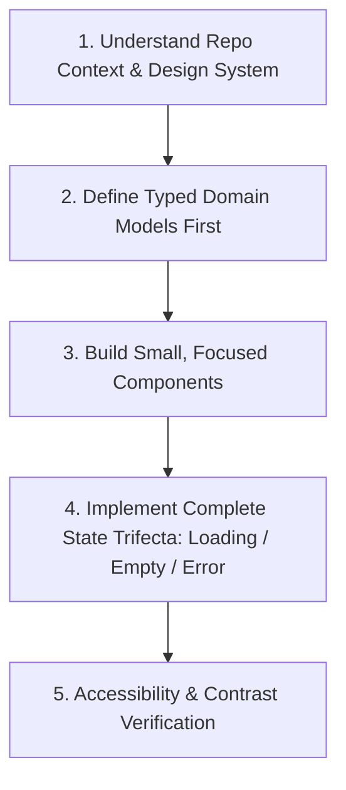

# Anti-AI-Slop: Detection & Prevention Protocol for Frontend UI

**AI Slop in Frontend Development** is code and UI that exhibits a *"veneer of competence"*—it compiles, renders, and looks superficially flashy at first glance, but suffers from lazy visual cliches, poor architectural cohesion, broken accessibility, cognitive bloat, and maintainability rot.

This skill equips agents and engineers to systematically diagnose, dismantle, and prevent AI slop across all frontend layers.

---

## 1. The 4 Dimensions of Frontend AI Slop

```
                      +---------------------------------------+
                      |       FRONTEND AI SLOP TAXONOMY       |
                      +---------------------------------------+
                                          |
         +-----------------+--------------+-----------------+-----------------+
         |                 |                                |                 |
         v                 v                                v                 v
   1. VISUAL CLICHES  2. ARCHITECTURAL ROT           3. UX & ACCESSIBILITY  4. CODE NOISE
   - Purple neon glow  - Monolithic JSX blobs        - Clickable <div>s     - Echoing comments
   - Glassmorphism spam- useEffect state sync cascades- Missing error/empty - Swallowed errors
   - Buzzword hero copy- Arbitrary Tailwind magic     - Zero keyboard nav    - Duplicate helpers
   - Fake sparklines   - Hardcoded mock data arrays  - Low-contrast text    - Defensive bloat
```

---

## 2. Detection Checklist: Hallmarks of AI-Slop

When reviewing or generating frontend code, check against these high-signal red flags:

### A. Visual & Aesthetic Smells
- [ ] **The "Vibe Coder" Palette**: Generic dark background (`#0D0D12`) paired with glowing neon purple/cyan blur blobs (`blur-3xl bg-purple-600/30`), frosted glassmorphism overlays on every card, and gradient text on every header.
- [ ] **Buzzword Soup Copy**: Hero copy reading *"Empower your digital paradigm with next-generation automated synergy"* instead of plain, descriptive human language.
- [ ] **Fake Dashboard Widgets**: Decorative sparkline charts, progress dials, or metric cards that don't reflect any backing domain state, have zero interactive tooltips, or lack units.
- [ ] **Excessive Floating Accents**: Floating decorative 3D shapes, spinning rings, particle backgrounds, or bouncy entrance animations that distract from content and degrade Core Web Vitals.
- [ ] **Inconsistent Geometry**: Random border radiuses (`rounded-3xl` next to `rounded-sm`) and arbitrary margin/padding values (`p-[19px]`, `mt-[37px]`) with no systematic spacing scale.

👉 *See [Visual Design Smells Reference](./references/visual-design-smells.md) for deep dives and visual breakdowns.*

### B. Component & Architecture Smells
- [ ] **The Mega-Component**: A single 600+ line `.tsx` file that handles network requests, local form state, modal logic, tab switching, and renders 20 nested sub-elements without modular decomposition.
- [ ] **`useEffect` Sync Cascades**: Using `useEffect` to copy props into state, sync filtered arrays, or trigger secondary state updates that should simply be computed inline via `useMemo` or plain variables.
- [ ] **Arbitrary Tailwind Abuse**: Mixing design token classes with inline arbitrary values (`bg-[#1a202c] text-[13.5px] max-w-[423px]`) instead of adhering to the project's established tokens and utilities.
- [ ] **Ghost / Mock Data in Production Files**: Component files containing hardcoded `const sampleTasks = [...]` arrays that masquerade as real data, masking backend integration gaps.
- [ ] **Duplicate Utility Sprawl**: Re-implementing a date formatter, classname merger (`cn`), or fetch wrapper in 4 different files because the AI didn't check existing repository helpers.

👉 *See [Architecture & Code Smells Reference](./references/architecture-code-smells.md) for code patterns.*

### C. UX & Accessibility Smells
- [ ] **Clickable Non-Interactive Elements**: `<div onClick={...}>` or `<span onClick={...}>` without `role="button"`, `tabIndex={0}`, or keyboard `onKeyDown` handlers.
- [ ] **Missing State Trifecta**: Handling only the "happy path" while completely omitting:
  1. *Loading State*: No skeleton or spinner, causing layout shift (CLS).
  2. *Empty State*: Renders a blank white void when arrays are empty (`[]`).
  3. *Error State*: Silent failures, unhandled exceptions, or generic non-actionable alerts.
- [ ] **Unlabelled Icon Buttons**: `<button><TrashIcon /></button>` with no `aria-label`, `title`, or screen-reader text.
- [ ] **Mobile Disregard**: Hardcoded pixel widths (`w-[650px]`) that overflow viewports, lack flex-wrapping, or have touch targets smaller than 44x44px.
- [ ] **Unusable Color Contrast**: Low-contrast light gray text (`#A0AEC0`) on white backgrounds that fails WCAG AA standards.

### D. Code Semantics & Cleanliness Smells
- [ ] **Echoing / No-Value Comments**: Comments that restate code syntax verbatim:
  ```typescript
  // BAD AI SLOP:
  // Set is loading to true
  setIsLoading(true);
  // Render the header container
  <header className="header">
  ```
- [ ] **Defensive Error Swallowing**:
  ```typescript
  // BAD AI SLOP:
  try {
    await submitForm();
  } catch (err) {
    console.error("error occurred:", err); // Silent error, zero feedback to user!
  }
  ```
- [ ] **Type Any / Blind Assertions**: Sprinkling `any` or `as unknown as Type` across interfaces instead of defining robust domain types.

---

## 3. The Anti-Slop Workflow & Prevention Rules

Follow this 5-step protocol whenever developing frontend interfaces:



### Rule 1: Adopt a Grounded Visual Metaphor (No Neon Cliches)
- Replace generic neon gradients and AI dark-mode blobs with a cohesive, deliberate design language:
  - *Example (Project Camp)*: Physical stationery, warm ivory cardstock (`#FBF9F5`), brass clips, wax seals, double-ruled ledgers.
  - *Example (Developer Tooling)*: Crisp monospace typography, high-contrast borders, dense tabular data, deliberate status badges.
- Never use AI buzzword copy. Write clear, human-focused headings and descriptions that plainly describe what the software does.

### Rule 2: Derive State, Don't Sync It
- **NEVER** use `useEffect` to synchronize props to local state or calculate filtered lists:
  ```typescript
  // SLOP:
  useEffect(() => {
    setFiltered(tasks.filter(t => t.status === filter));
  }, [tasks, filter]);

  // CRAFTED:
  const filtered = useMemo(() => {
    return tasks.filter(t => filter === 'all' ? true : t.status === filter);
  }, [tasks, filter]);
  ```

### Rule 3: Enforce Component Modularity (< 250 Lines)
- If a component exceeds 250 lines, decompose it:
  - Extract child cards, list items, and modal bodies into dedicated files.
  - Extract custom hooks (`useProjectData`, `useTaskFilter`) for non-trivial state.
  - Keep JSX trees readable at a single glance.

### Rule 4: Mandatory State Trifecta
Every data-dependent view must provide explicit UI for:
1. **Loading**: Smooth pulse skeleton matching the final card dimensions.
2. **Empty**: Engaging, contextual empty state with a clear call-to-action button (e.g. *"No tasks created yet — Create your first task"*).
3. **Error**: Actionable recovery message with retry trigger (e.g. *"Failed to load tasks — [Try Again]"*).

### Rule 5: Semantic HTML & Accessibility Baseline
- Use `<button>` for actions and `<Link>` / `<a>` for navigation. Never `<div onClick>`.
- Provide `aria-label` or `title` on every icon-only button.
- Ensure text passes WCAG AA contrast (minimum 4.5:1 for body copy).
- Support keyboard navigation (`Tab`, `Enter`, `Escape` for modals).

---

## 4. Side-by-Side Comparison

👉 *Read [Slop vs. Crafted Code Examples](./examples/slop-vs-crafted.md) for full side-by-side implementations.*

| Aspect | AI Slop Code | Human-Crafted Code |
| :--- | :--- | :--- |
| **Styling** | `bg-gradient-to-r from-purple-500 to-indigo-500 backdrop-blur-xl p-[23px]` | Standardized design tokens: `bg-card border-border rounded-xl paper-shadow` |
| **Component Size** | 700-line monolithic file with 14 inline modals | Decomposed into `<TaskCard />`, `<TaskModal />`, `<TaskList />` (< 150 lines each) |
| **Accessibility** | `<div onClick={fn}>` with no tabIndex or ARIA | `<button onClick={fn} aria-label="Delete task">` with focus rings |
| **Comments** | `// Increment counter by one` | High-level architectural context or non-obvious business invariants |
| **Error Handling** | Swallowed in `try/catch` with `console.log` | Surfaced to user via typed toast, alert banner, and recovery action |

---

## 5. Verification Commands

Before approving any frontend UI PR or diff, execute:
1. **Type Safety Verification**: `npx tsc --noEmit` (Must pass with 0 errors).
2. **Linter Check**: `npm run lint` or `npx eslint .` (Zero warnings/errors).
3. **Build Check**: `npm run build` (Ensures static prerender and bundle checks pass).
4. **Visual & Responsive Audit**: Test mobile (375px), tablet (768px), and desktop (1440px) viewports using the Antigravity browser agent.
